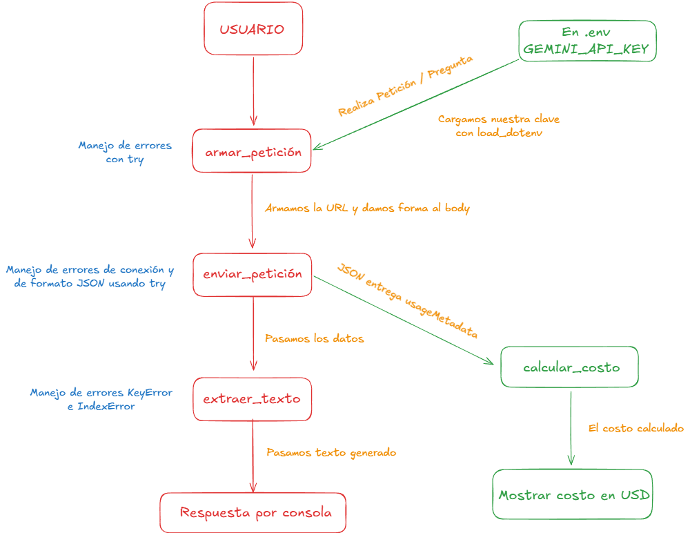

# Decisión de arquitectura: elección del modelo

Fecha de la comparación: Miercoles 24 de Octubre del 2026
Nombre de la miniaplicación: "WIL - Asistente de WATERisLIFE"

La miniaplicación busca orientar a potenciales donantes sobre cómo
colaborar, conocer el impacto de sus aportes y consultar información
de transparencia. Utiliza prompts con respuestas estructuradas en JSON.

## Modelo elegido

Elegí el modelo: **gemini-3.6-flash-lite**

Mi miniaplicación sirve para: Detectar el mejor modelo de IA según criterios determinados.

Los criterios considerados fueron:

- Tiempo de respuesta.
- Costo estimado por solicitud.
- Éxito de las solicitudes.
- Claridad de las respuestas.
- Consistencia de la estructura JSON.

## Diagrama de arquitectura

## Comparación de candidatos

Se realizaron cuatro solicitudes por modelo utilizando:

- Pregunta: "¿Cual es la latencia".
- Instrucción de sistema: "Eres un asistente amigable y respondes en máximo 2 frases."
- El mismo script para ambos modelos.

La latencia corresponde al tiempo medido por el script durante
el envío y la recepción de la solicitud.

El costo se estima a partir del consumo de tokens informado por
la API y las tarifas configuradas para cada modelo.

## Resultados de la comparación

| Criterio | gemini-3.6-flash | gemini-3.5-flash-lite |
|---|---|---|
| Tarifa de entrada: USD por millón de tokens de texto | 0.75 | 0.30 |
| Tarifa de salida: USD por millón de tokens, incluyendo razonamiento | 3.75 | 2.50 |
| Latencias observadas, en segundos | 6.01; 17.63; 5.92; 3.94 | 2.22; 2.26; 2.35; 2.70 |
| Latencia promedio informada por el script | 8.37 segundos | 2.38 segundos |
| Costo promedio estimado por solicitud | USD 0.001506 | USD 0.000102 |
| Peticiones exitosas | 4 de 4 | 4 de 4 |
| Errores en esta ejecución | Ninguno | Ninguno |
| Calidad observada | Respuestas claras y relacionadas con la pregunta | Respuestas claras y relacionadas con la pregunta |

### Fuente de las tarifas

Google — Gemini Developer API pricing:

https://ai.google.dev/gemini-api/docs/pricing

Se utilizaron las tarifas de la modalidad Standard, Paid Tier.
Los costos presentados son estimaciones de referencia y no
representan necesariamente cargos realizados en mi cuenta.
  
## Justificación de la elección

Elegí **gemini-3.5-flash-lite** porque, en esta comparación,
presentó una latencia promedio de 2.38 segundos frente a
8.37 segundos de gemini-3.6-flash.

También presentó un menor costo promedio estimado:
USD 0.000102 frente a USD 0.001506 por solicitud.

Ambos modelos completaron las cuatro solicitudes. Por ello,
esta ejecución no muestra una diferencia en la tasa de éxito.
La elección se fundamenta principalmente en el menor tiempo
de respuesta y costo observados para Lite.

## Alternativa descartada

Descarté **gemini-3.6-flash** para esta versión de la
miniaplicación porque presentó mayor latencia y costo estimado
en la comparación realizada.

Sus respuestas fueron claras y completó las cuatro solicitudes.
La decisión corresponde a los criterios y resultados de esta prueba.

## Consistencia del banco de prompts

En una prueba independiente realizada con
`gemini-3.5-flash-lite`, se obtuvieron estos resultados:

| Prompt | Respuestas válidas | Intentos |
|---|---|---|
| Donaciones | 3 | 3 |
| Impacto | 3 | 3 |
| Transparencia | 3 | 3 |
| Total | 9 | 9 |

La prueba de consistencia verifica la estructura JSON mediante
el validador del proyecto. Es independiente de la comparación
de latencia y costo descrita anteriormente.

## Limitaciones

- Se realizaron solamente cuatro solicitudes por modelo.
  Esta muestra es pequeña y no permite garantizar el mismo
  rendimiento en otras ejecuciones.

- La comparación utilizó una consulta general sobre latencia.
  No constituye una evaluación completa de la calidad de las
  respuestas sobre WATERisLIFE.

- La prueba del banco de prompts comprueba la estructura de
  las respuestas; no demuestra por sí sola su exactitud factual.

- Los tiempos pueden variar según las condiciones de la red,
  la carga del servicio y la extensión de la respuesta.